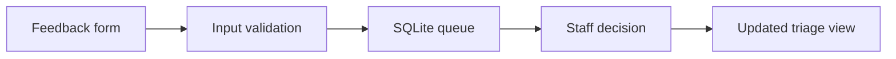

# Discord Feedback Triage

**Persisted player feedback with staff review state**

  

> **Documentation-only portfolio case study.** The source under [`src/public_interface.py`](src/public_interface.py) is intentionally unimplemented and raises `NotImplementedError`. This is **not** a runnable bot, a deployment package or independently verified production evidence.

## Why this module exists

Community feedback easily disappears in chat or gets repeatedly submitted. Structured intake and a staff queue help distinguish new ideas from reviewed, deferred and rejected feedback while preserving enough context to act.

**Technology context:** Python, discord.py modals, SQLite/aiosqlite, background tasks. These technologies describe the private module's documented domain; public executable implementation is not provided.

## Workflow at a glance

1. Collect a structured feedback message through a form
2. Validate text and create a persistent record
3. Route the record to a private staff review surface
4. Allow authorized reviewers to record a decision
5. Update the displayed queue without losing historical context

These stages summarize the public project description; the exact runtime and private integration details cannot be independently verified from the public skeleton.

## Engineering challenges

| Topic | Why it matters | How it should be verified |
|---|---|---|
| Duplicate submissions | Players may submit the same idea several times | Use clear duplicate/merge policy and synthetic fixtures |
| Long input | Feedback can contain excessive text or unsafe mentions | Validate length, sanitize display and mention policy |
| Review concurrency | Two staff members may review simultaneously | Use optimistic locking or a transactional state change |
| Recovery after restart | Persistent UI may become detached from stored records | Test view reconstruction and missing messages |

## Component boundary

This diagram is **conceptual**, not a snapshot of private production architecture. See the [design notes](docs/ARCHITECTURE.md) for boundaries, failure scenarios and test ideas.

## Repository contents and status

- [`src/public_interface.py`](src/public_interface.py) — non-runnable, documented public interface skeleton
- [`docs/ARCHITECTURE.md`](docs/ARCHITECTURE.md) — engineering design notes (no operational secrets)
- [`examples/config.example.jsonc`](examples/config.example.jsonc) — illustrative configuration shape, **not** a production configuration
- [`NOTICE.md`](NOTICE.md) and [`SECURITY.md`](SECURITY.md) — publication/security boundary

**Portfolio role:** Feature-level feedback case study, not a deployable stand-alone product. No public tests, executable deployment or usage metrics are claimed here. For verifiable code, inspect the [FastAPI backend demo](https://github.com/Scumbagsss/priority-access-bot), [ticket workflow](https://github.com/Scumbagsss/advanced-discord-ticket-bot) and [monitoring pipeline](https://github.com/Scumbagsss/dayz-server-monitor-bot).

**Related systems:** [discord-support-workflow-bot](https://github.com/Scumbagsss/discord-support-workflow-bot) · [BOT](https://github.com/Scumbagsss/BOT).

**Contact:** Discord `scumbagsss` · Telegram [@dilarion](https://t.me/dilarion)
